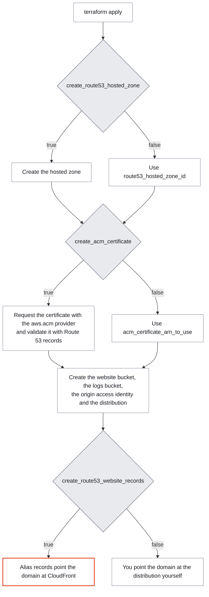
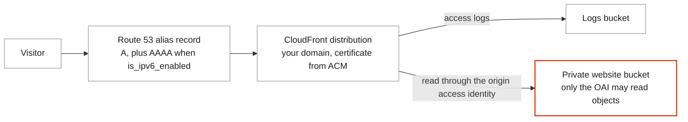

<div align="center">


# 🌐 terraform-aws-static-website

### A Terraform module for a static website on S3, CloudFront and Route 53.

**It creates a private S3 bucket, a CloudFront distribution that reads from it through an origin
access identity, an ACM certificate, a Route 53 zone and alias records, and a bucket for access
logs.** Every piece that can live outside the module (the zone, the certificate, the DNS records)
has a switch. It works with Terraform and OpenTofu, and it is not published on a registry yet.

<br>

[](LICENSE)
[](https://www.terraform.io/)
[](https://opentofu.org/)
[](https://registry.terraform.io/providers/hashicorp/aws/latest)
<br>
[](https://github.com/agusgonzaleznic/terraform-aws-static-website/actions/workflows/pipeline.yml)
[](#-quick-start)

<br>

**[Quick start](#-quick-start) · [What it creates](#-what-it-creates) · [Examples](#-examples) · [Inputs](#inputs) · [Outputs](#outputs) · [CI](#-what-ci-checks) · [Local checks](#-local-checks) · [Limits](#-what-it-doesnt-do) · [Support](#-support-this-project)**

</div>

---

## 🧭 What this is

You give the module a domain name and a name prefix, and it builds the bucket, the CDN, the
certificate and the DNS records around them. By default the bucket is private and its policy lets
only CloudFront read it, and CloudFront redirects viewers to HTTPS (the viewer protocol policy is
`redirect-to-https` unless you change it).

The module doesn't upload your site. It builds the place the files go.

| Tool | Supported versions | Tested in CI |
|---|---|---|
| Terraform | `>= 1.6` | 1.15.7 |
| OpenTofu | `>= 1.6` | 1.12.3 |
| AWS provider | `>= 5.30` | the newest version that constraint allows (6.64.0 in the run on `main` on 16 September 2026) |

CI tests one Terraform version and one OpenTofu version, so older ones in the supported range are
not tested.

The `logs_bucket` dependency
([`terraform-aws-s3-bucket`](https://github.com/agusgonzaleznic/terraform-aws-s3-bucket)) comes in
through a git source pinned to the tag `v1.1.0`, not a registry address, so it resolves the same
under Terraform and OpenTofu.

---

## ⚡ Quick start

**This module isn't on the Terraform Registry.** The Registry answers 404 for
`agusgonzaleznic/static-website/aws` (checked 14 November 2026). The repository has no tags and no
releases yet either, so pin a commit. A `git::https` source with a `ref` is the form
[Terraform's module documentation](https://developer.hashicorp.com/terraform/language/modules/sources)
gives for a generic Git repository, and
[OpenTofu's](https://opentofu.org/docs/language/modules/sources/) matches it. `ref` takes anything
`git checkout` accepts, a commit SHA included.

Get the commit you want to pin:

```
git ls-remote https://github.com/agusgonzaleznic/terraform-aws-static-website.git refs/heads/main
```

Then call the module. It needs two provider configurations: `aws.main` for the bucket, the
distribution and Route 53, and `aws.acm` for the certificate. CloudFront takes certificates from
us-east-1 (the `acm_certificate_arn_to_use` input says so), so point `aws.acm` there.

```hcl
provider "aws" {
  alias  = "main"
  region = "eu-central-1"
}

provider "aws" {
  alias  = "acm"
  region = "us-east-1"
}

module "website" {
  source = "git::https://github.com/agusgonzaleznic/terraform-aws-static-website.git?ref=<commit-sha>"

  providers = {
    aws.main = aws.main
    aws.acm  = aws.acm
  }

  name_prefix         = "example"
  website_domain_name = "example.com"
}
```

`name_prefix` and `website_domain_name` are the only required inputs. The bucket takes the domain
name as its name, so the domain has to be free as an S3 bucket name. The five directories under
`examples/` use the same shape, and CI runs each of them.

If you let the module create the Route 53 zone, it can't delegate your domain to it for you. The
zone's name servers come out as `hosted_zone_name_servers`.

---

## 📦 What it creates



Once it's applied, a request travels like this:



These are the resources, named as the code declares them.

| Resource | What the module does with it | When |
|---|---|---|
| `aws_s3_bucket.website` | The website bucket, named after `website_domain_name` | always |
| `aws_s3_bucket_versioning.website` | Versioning from `website_versioning_status` and `website_versioning_mfa_delete` | always |
| `aws_s3_bucket_cors_configuration.website` | CORS for `https://<domain>`, plus `http://<domain>` when the viewer protocol policy is `allow-all`, plus `website_cors_additional_allowed_origins` | always |
| `aws_s3_bucket_logging.website` | Server access logs to the logs bucket under the prefix `website/` | always |
| `aws_s3_bucket_ownership_controls.website` | Object ownership `BucketOwnerPreferred` | always |
| `aws_s3_bucket_acl.website` | The canned ACL from `website_bucket_acl` (`private` by default) | always |
| `aws_s3_bucket_policy.website` | One statement: the origin access identity may `s3:GetObject` on every object | always |
| `aws_s3_bucket_public_access_block.website_bucket_public_access_block` | All four public access blocks on | always |
| `aws_s3_bucket_server_side_encryption_configuration.website_bucket_website_server_side_encryption_configuration` | Default encryption from `website_server_side_encryption_configuration` | only when that input isn't empty |
| `aws_cloudfront_origin_access_identity.cf_oai` | The identity CloudFront reads the bucket with | always |
| `aws_cloudfront_distribution.website` | The distribution: your domain as an alias (plus `www.<domain>` when `www_website_redirect_enabled`, which is on by default), TLS `TLSv1.2_2021` over SNI, access logs to the logs bucket under `cloudfront_website`, the default behaviour on the managed policies the code comments call Managed-CachingOptimized and Managed-CORS-S3Origin | always |
| `module.logs_bucket` | The access log bucket, named from `name_prefix`, public access blocked, built by [`terraform-aws-s3-bucket`](https://github.com/agusgonzaleznic/terraform-aws-s3-bucket) at the tag `v1.1.0` | always |
| `aws_route53_zone.hosted_zone` | The hosted zone for `website_domain_name` | when `create_route53_hosted_zone` |
| `aws_acm_certificate.cert` | A DNS-validated certificate for `*.<domain>` with the bare domain as an alternative name | when `create_acm_certificate` |
| `aws_route53_record.acm_certificate_validation_records` | The validation records, in the created zone or in `route53_hosted_zone_id` | when `create_acm_certificate` |
| `aws_acm_certificate_validation.cert_validation` | Waits for the certificate to validate | when `create_acm_certificate` |
| `aws_route53_record.website_cloudfront_record` | An `A` alias from the domain to the distribution | when `create_route53_website_records` |
| `aws_route53_record.website_cloudfront_record_ipv6` | An `AAAA` alias from the domain to the distribution | when `is_ipv6_enabled` and `create_route53_website_records` |
| `aws_route53_record.www_website_record` | An `A` alias from `www.<domain>` to the distribution | when `www_website_redirect_enabled` and `create_route53_website_records` |
| `aws_route53_record.www_website_record_ipv6` | An `AAAA` alias from `www.<domain>` to the distribution | when `is_ipv6_enabled`, `www_website_redirect_enabled` and `create_route53_website_records` |

---

## 📁 Examples

Each directory under `examples/` is a complete call of the module with a mock provider that points at
LocalStack. CI validates and plans every one of them.

| Directory | What it sets |
|---|---|
| [`examples/complete`](examples/complete) | The module creates the certificate and the zone, and the website bucket gets `AES256` default encryption |
| [`examples/no-cert`](examples/no-cert) | You bring the certificate (`create_acm_certificate = false` and `acm_certificate_arn_to_use`) |
| [`examples/no-hosted-zone`](examples/no-hosted-zone) | You bring the zone (`create_route53_hosted_zone = false` and `route53_hosted_zone_id`) |
| [`examples/no-cert-no-hosted-zone`](examples/no-cert-no-hosted-zone) | You bring both |
| [`examples/ordered-cache-behavior`](examples/ordered-cache-behavior) | An extra `custom_origin_config` origin for `api.test.com` and an ordered cache behaviour for `api/*` |

---

## 📚 Reference

This block is generated from the code by the `terraform_docs` pre-commit hook, so the inputs and
outputs here are the ones in `variables.tf` and `outputs.tf`.

<!-- BEGIN_TF_DOCS -->
## Requirements

| Name | Version |
| ---- | ------- |
| <a name="requirement_terraform"></a> [terraform](#requirement\_terraform) | >= 1.6 |
| <a name="requirement_aws"></a> [aws](#requirement\_aws) | >= 5.30 |

## Providers

| Name | Version |
| ---- | ------- |
| <a name="provider_aws.acm"></a> [aws.acm](#provider\_aws.acm) | >= 5.30 |
| <a name="provider_aws.main"></a> [aws.main](#provider\_aws.main) | >= 5.30 |

## Modules

| Name | Source | Version |
| ---- | ------ | ------- |
| <a name="module_logs_bucket"></a> [logs\_bucket](#module\_logs\_bucket) | github.com/agusgonzaleznic/terraform-aws-s3-bucket | v1.1.0 |

## Resources

| Name | Type |
| ---- | ---- |
| [aws_acm_certificate.cert](https://registry.terraform.io/providers/hashicorp/aws/latest/docs/resources/acm_certificate) | resource |
| [aws_acm_certificate_validation.cert_validation](https://registry.terraform.io/providers/hashicorp/aws/latest/docs/resources/acm_certificate_validation) | resource |
| [aws_cloudfront_distribution.website](https://registry.terraform.io/providers/hashicorp/aws/latest/docs/resources/cloudfront_distribution) | resource |
| [aws_cloudfront_origin_access_identity.cf_oai](https://registry.terraform.io/providers/hashicorp/aws/latest/docs/resources/cloudfront_origin_access_identity) | resource |
| [aws_route53_record.acm_certificate_validation_records](https://registry.terraform.io/providers/hashicorp/aws/latest/docs/resources/route53_record) | resource |
| [aws_route53_record.website_cloudfront_record](https://registry.terraform.io/providers/hashicorp/aws/latest/docs/resources/route53_record) | resource |
| [aws_route53_record.website_cloudfront_record_ipv6](https://registry.terraform.io/providers/hashicorp/aws/latest/docs/resources/route53_record) | resource |
| [aws_route53_record.www_website_record](https://registry.terraform.io/providers/hashicorp/aws/latest/docs/resources/route53_record) | resource |
| [aws_route53_record.www_website_record_ipv6](https://registry.terraform.io/providers/hashicorp/aws/latest/docs/resources/route53_record) | resource |
| [aws_route53_zone.hosted_zone](https://registry.terraform.io/providers/hashicorp/aws/latest/docs/resources/route53_zone) | resource |
| [aws_s3_bucket.website](https://registry.terraform.io/providers/hashicorp/aws/latest/docs/resources/s3_bucket) | resource |
| [aws_s3_bucket_acl.website](https://registry.terraform.io/providers/hashicorp/aws/latest/docs/resources/s3_bucket_acl) | resource |
| [aws_s3_bucket_cors_configuration.website](https://registry.terraform.io/providers/hashicorp/aws/latest/docs/resources/s3_bucket_cors_configuration) | resource |
| [aws_s3_bucket_logging.website](https://registry.terraform.io/providers/hashicorp/aws/latest/docs/resources/s3_bucket_logging) | resource |
| [aws_s3_bucket_ownership_controls.website](https://registry.terraform.io/providers/hashicorp/aws/latest/docs/resources/s3_bucket_ownership_controls) | resource |
| [aws_s3_bucket_policy.website](https://registry.terraform.io/providers/hashicorp/aws/latest/docs/resources/s3_bucket_policy) | resource |
| [aws_s3_bucket_public_access_block.website_bucket_public_access_block](https://registry.terraform.io/providers/hashicorp/aws/latest/docs/resources/s3_bucket_public_access_block) | resource |
| [aws_s3_bucket_server_side_encryption_configuration.website_bucket_website_server_side_encryption_configuration](https://registry.terraform.io/providers/hashicorp/aws/latest/docs/resources/s3_bucket_server_side_encryption_configuration) | resource |
| [aws_s3_bucket_versioning.website](https://registry.terraform.io/providers/hashicorp/aws/latest/docs/resources/s3_bucket_versioning) | resource |

## Inputs

| Name | Description | Type | Default | Required |
| ---- | ----------- | ---- | ------- | :------: |
| <a name="input_acm_certificate_arn_to_use"></a> [acm\_certificate\_arn\_to\_use](#input\_acm\_certificate\_arn\_to\_use) | ACM Certificate ARN to use in case you disable automatic certificate creation. Certificate must be in us-east-1 region. | `string` | `""` | no |
| <a name="input_aws_accounts_with_read_view_log_bucket"></a> [aws\_accounts\_with\_read\_view\_log\_bucket](#input\_aws\_accounts\_with\_read\_view\_log\_bucket) | List of AWS accounts with read permissions to log bucket | `list(string)` | `[]` | no |
| <a name="input_cloudfront_additional_origins"></a> [cloudfront\_additional\_origins](#input\_cloudfront\_additional\_origins) | (Optional) A list of additional origins besides the web site | <pre>list(object({<br/>    connection_attempts = optional(number)<br/>    connection_timeout  = optional(number)<br/>    custom_origin_config = optional(object({<br/>      http_port                = number<br/>      https_port               = number<br/>      origin_protocol_policy   = string<br/>      origin_ssl_protocols     = list(string)<br/>      origin_keepalive_timeout = optional(number)<br/>      origin_read_timeout      = optional(number)<br/>    }))<br/>    domain_name = string<br/>    custom_header : optional(list(<br/>      object({<br/>        name  = string<br/>        value = string<br/>      }))<br/>    )<br/>    origin_access_control_id = optional(string)<br/>    origin_id                = string<br/>    origin_path              = optional(string)<br/>    # TODO support origin_shield<br/>    s3_origin_config = optional(object({<br/>      origin_access_identity = string<br/>    }))<br/>  }))</pre> | `[]` | no |
| <a name="input_cloudfront_allowed_cached_methods"></a> [cloudfront\_allowed\_cached\_methods](#input\_cloudfront\_allowed\_cached\_methods) | (Optional) Specifies which methods are allowed and cached by CloudFront. Can be GET, PUT, POST, DELETE or HEAD. Defaults to GET and HEAD | `list(string)` | <pre>[<br/>  "GET",<br/>  "HEAD"<br/>]</pre> | no |
| <a name="input_cloudfront_custom_error_responses"></a> [cloudfront\_custom\_error\_responses](#input\_cloudfront\_custom\_error\_responses) | A list of custom error responses | <pre>list(object({<br/>    error_caching_min_ttl = number<br/>    error_code            = number<br/>    response_code         = number<br/>    response_page_path    = string<br/>  }))</pre> | `[]` | no |
| <a name="input_cloudfront_default_root_object"></a> [cloudfront\_default\_root\_object](#input\_cloudfront\_default\_root\_object) | (Optional) - The object that you want CloudFront to return (for example, index.html) when an end user requests the root URL. Defaults to index.html | `string` | `"index.html"` | no |
| <a name="input_cloudfront_enable_compression"></a> [cloudfront\_enable\_compression](#input\_cloudfront\_enable\_compression) | (Optional, Default:false) Enable compression with Gzip or Brotli for requests with a valid Accept-Encoding header | `bool` | `false` | no |
| <a name="input_cloudfront_function_association"></a> [cloudfront\_function\_association](#input\_cloudfront\_function\_association) | (Optional - up to 2 per distribution) List containing information to associate a CF function to cloudfront. The first field is `event_type` of the CF function associated with default cache behavior, it can be viewer-request or viewer-response | <pre>list(object({<br/>    event_type   = string<br/>    function_arn = string<br/>  }))</pre> | `[]` | no |
| <a name="input_cloudfront_geo_restriction_locations"></a> [cloudfront\_geo\_restriction\_locations](#input\_cloudfront\_geo\_restriction\_locations) | (Optional) - The ISO 3166-1-alpha-2 codes for which you want CloudFront either to distribute your content (whitelist) or not distribute your content (blacklist). Defaults to [] | `list(string)` | `[]` | no |
| <a name="input_cloudfront_geo_restriction_type"></a> [cloudfront\_geo\_restriction\_type](#input\_cloudfront\_geo\_restriction\_type) | The method that you want to use to restrict distribution of your content by country: none, whitelist, or blacklist. Defaults to none | `string` | `"none"` | no |
| <a name="input_cloudfront_http_version"></a> [cloudfront\_http\_version](#input\_cloudfront\_http\_version) | (Optional) - The maximum HTTP version to support on the distribution. Allowed values are http1.1 and http2. The default is http2. | `string` | `"http2"` | no |
| <a name="input_cloudfront_ordered_cache_behaviors"></a> [cloudfront\_ordered\_cache\_behaviors](#input\_cloudfront\_ordered\_cache\_behaviors) | A list of custom ordered cache behaviors | <pre>list(object({<br/>    allowed_methods           = list(string)<br/>    cached_methods            = list(string)<br/>    cache_policy_id           = string<br/>    compress                  = optional(bool)<br/>    default_ttl               = optional(number)<br/>    field_level_encryption_id = optional(string)<br/>    # forwarded_values will not be supported as Hashicorp had already deprecated it at the time of implementing this module<br/>    # TODO support lambda_function_association and function_association<br/>    max_ttl                    = optional(number)<br/>    min_ttl                    = optional(number)<br/>    origin_request_policy_id   = string<br/>    path_pattern               = optional(string)<br/>    realtime_log_config_arn    = optional(string)<br/>    response_headers_policy_id = optional(string)<br/>    smooth_streaming           = optional(bool)<br/>    target_origin_id           = string<br/>    # TODO support trusted_key_groups and trusted_signers<br/>    viewer_protocol_policy = string<br/>  }))</pre> | `[]` | no |
| <a name="input_cloudfront_price_class"></a> [cloudfront\_price\_class](#input\_cloudfront\_price\_class) | (Optional) - The price class for this distribution. One of PriceClass\_All, PriceClass\_200, PriceClass\_100. Defaults to PriceClass\_100 | `string` | `"PriceClass_100"` | no |
| <a name="input_cloudfront_viewer_protocol_policy"></a> [cloudfront\_viewer\_protocol\_policy](#input\_cloudfront\_viewer\_protocol\_policy) | Use this element to specify the protocol that users can use to access the files in the origin specified by TargetOriginId when a request matches the path pattern in PathPattern. One of allow-all, https-only, or redirect-to-https. Defautls to redirect-to-https | `string` | `"redirect-to-https"` | no |
| <a name="input_cloudfront_web_acl_id"></a> [cloudfront\_web\_acl\_id](#input\_cloudfront\_web\_acl\_id) | (Optional) A unique identifier that specifies the AWS WAF web ACL, if any, to associate with this distribution. | `string` | `null` | no |
| <a name="input_cloudfront_website_retain_on_delete"></a> [cloudfront\_website\_retain\_on\_delete](#input\_cloudfront\_website\_retain\_on\_delete) | (Optional) - Disables the distribution instead of deleting it when destroying the resource through Terraform. If this is set, the distribution needs to be deleted manually afterwards. Defaults to false. | `bool` | `false` | no |
| <a name="input_cloudfront_website_wait_for_deployment"></a> [cloudfront\_website\_wait\_for\_deployment](#input\_cloudfront\_website\_wait\_for\_deployment) | (Optional) - If enabled, the resource will wait for the distribution status to change from InProgress to Deployed. Setting this tofalse will skip the process. Defaults to true. | `bool` | `true` | no |
| <a name="input_comment_for_cloudfront_website"></a> [comment\_for\_cloudfront\_website](#input\_comment\_for\_cloudfront\_website) | Comment for the Website CloudFront Distribution | `string` | `""` | no |
| <a name="input_create_acm_certificate"></a> [create\_acm\_certificate](#input\_create\_acm\_certificate) | Enable or disable automatic ACM certificate creation. If set to false, the variable acm\_certificate\_arn\_to\_use is required. Defaults to true | `bool` | `true` | no |
| <a name="input_create_route53_hosted_zone"></a> [create\_route53\_hosted\_zone](#input\_create\_route53\_hosted\_zone) | Enable or disable Route 53 hosted zone creation. If set to false, the variable route53\_hosted\_zone\_id is required. Defaults to true | `bool` | `true` | no |
| <a name="input_create_route53_website_records"></a> [create\_route53\_website\_records](#input\_create\_route53\_website\_records) | Enable or disable creation of Route 53 records in the hosted zone. Defaults to true | `bool` | `true` | no |
| <a name="input_is_ipv6_enabled"></a> [is\_ipv6\_enabled](#input\_is\_ipv6\_enabled) | (Optional) - Whether the IPv6 is enabled for the distribution. Defaults to true | `bool` | `true` | no |
| <a name="input_log_bucket_force_destroy"></a> [log\_bucket\_force\_destroy](#input\_log\_bucket\_force\_destroy) | (Optional, Default:false) A boolean that indicates all objects (including any locked objects) should be deleted from the log bucket so that the bucket can be destroyed without error. These objects are not recoverable. | `bool` | `false` | no |
| <a name="input_log_bucket_versioning_mfa_delete"></a> [log\_bucket\_versioning\_mfa\_delete](#input\_log\_bucket\_versioning\_mfa\_delete) | (Optional) Specifies whether MFA delete is enabled in the bucket versioning configuration. Valid values: Enabled or Disabled. Defaults to Disabled | `string` | `"Disabled"` | no |
| <a name="input_log_bucket_versioning_status"></a> [log\_bucket\_versioning\_status](#input\_log\_bucket\_versioning\_status) | (Optional) The versioning state of the bucket. Valid values: Enabled or Suspended. Defaults to Enabled | `string` | `"Enabled"` | no |
| <a name="input_name_prefix"></a> [name\_prefix](#input\_name\_prefix) | Name prefix for resources on AWS | `any` | n/a | yes |
| <a name="input_route53_hosted_zone_id"></a> [route53\_hosted\_zone\_id](#input\_route53\_hosted\_zone\_id) | The Route 53 hosted zone ID to use if create\_route53\_hosted\_zone is false | `string` | `""` | no |
| <a name="input_tags"></a> [tags](#input\_tags) | Resource tags | `map(string)` | `{}` | no |
| <a name="input_website_bucket_acl"></a> [website\_bucket\_acl](#input\_website\_bucket\_acl) | (Optional) The canned ACL to apply. Valid values are private, public-read, public-read-write, aws-exec-read, authenticated-read, and log-delivery-write. Defaults to private. | `string` | `"private"` | no |
| <a name="input_website_bucket_force_destroy"></a> [website\_bucket\_force\_destroy](#input\_website\_bucket\_force\_destroy) | (Optional, Default:false) A boolean that indicates all objects (including any locked objects) should be deleted from the bucket so that the bucket can be destroyed without error. These objects are not recoverable. | `bool` | `false` | no |
| <a name="input_website_cors_additional_allowed_origins"></a> [website\_cors\_additional\_allowed\_origins](#input\_website\_cors\_additional\_allowed\_origins) | (Optional) Specifies which origins are allowed besides the domain name specified | `list(string)` | `[]` | no |
| <a name="input_website_cors_allowed_headers"></a> [website\_cors\_allowed\_headers](#input\_website\_cors\_allowed\_headers) | (Optional) Specifies which headers are allowed. Defaults to Authorization and Content-Length | `list(string)` | <pre>[<br/>  "Authorization",<br/>  "Content-Length"<br/>]</pre> | no |
| <a name="input_website_cors_allowed_methods"></a> [website\_cors\_allowed\_methods](#input\_website\_cors\_allowed\_methods) | (Optional) Specifies which methods are allowed. Can be GET, PUT, POST, DELETE or HEAD. Defaults to GET and POST | `list(string)` | <pre>[<br/>  "GET",<br/>  "POST"<br/>]</pre> | no |
| <a name="input_website_cors_expose_headers"></a> [website\_cors\_expose\_headers](#input\_website\_cors\_expose\_headers) | (Optional) Specifies expose header in the response. | `list(string)` | `[]` | no |
| <a name="input_website_cors_max_age_seconds"></a> [website\_cors\_max\_age\_seconds](#input\_website\_cors\_max\_age\_seconds) | (Optional) Specifies time in seconds that browser can cache the response for a preflight request. Defaults to 3600 | `number` | `3600` | no |
| <a name="input_website_domain_name"></a> [website\_domain\_name](#input\_website\_domain\_name) | The domain name to use for the website | `string` | n/a | yes |
| <a name="input_website_error_document"></a> [website\_error\_document](#input\_website\_error\_document) | (Optional) An absolute path to the document to return in case of a 4XX error. Defaults to 404.html | `string` | `"404.html"` | no |
| <a name="input_website_index_document"></a> [website\_index\_document](#input\_website\_index\_document) | Amazon S3 returns this index document when requests are made to the root domain or any of the subfolders.  Defaults to index.html | `string` | `"index.html"` | no |
| <a name="input_website_server_side_encryption_configuration"></a> [website\_server\_side\_encryption\_configuration](#input\_website\_server\_side\_encryption\_configuration) | (Optional) Map containing server-side encryption configuration for the website bucket. Defaults to no encryption. See examples/complete/main.tf for configuration example. | `any` | `{}` | no |
| <a name="input_website_versioning_mfa_delete"></a> [website\_versioning\_mfa\_delete](#input\_website\_versioning\_mfa\_delete) | (Optional) Specifies whether MFA delete is enabled in the bucket versioning configuration. Valid values: Enabled or Disabled. Defaults to Disabled | `string` | `"Disabled"` | no |
| <a name="input_website_versioning_status"></a> [website\_versioning\_status](#input\_website\_versioning\_status) | (Optional) The versioning state of the bucket. Valid values: Enabled or Suspended. Defaults to Enabled | `string` | `"Enabled"` | no |
| <a name="input_www_website_bucket_acl"></a> [www\_website\_bucket\_acl](#input\_www\_website\_bucket\_acl) | (Optional) The canned ACL to apply. Valid values are private, public-read, public-read-write, aws-exec-read, authenticated-read, and log-delivery-write. Defaults to private. | `string` | `"private"` | no |
| <a name="input_www_website_bucket_force_destroy"></a> [www\_website\_bucket\_force\_destroy](#input\_www\_website\_bucket\_force\_destroy) | (Optional, Default:false) A boolean that indicates all objects (including any locked objects) should be deleted from the bucket so that the bucket can be destroyed without error. These objects are not recoverable. | `bool` | `false` | no |
| <a name="input_www_website_redirect_enabled"></a> [www\_website\_redirect\_enabled](#input\_www\_website\_redirect\_enabled) | (Optional) Whether to redirect www subdomain. Defaults to true. | `bool` | `true` | no |
| <a name="input_www_website_versioning_enabled"></a> [www\_website\_versioning\_enabled](#input\_www\_website\_versioning\_enabled) | (Optional) Enable versioning. Once you version-enable a bucket, it can never return to an unversioned state. You can, however, suspend versioning on that bucket. Defaults to true | `bool` | `true` | no |
| <a name="input_www_website_versioning_mfa_delete"></a> [www\_website\_versioning\_mfa\_delete](#input\_www\_website\_versioning\_mfa\_delete) | (Optional) Enable MFA delete for either change the versioning state of your bucket or permanently delete an object version. Default is false. This cannot be used to toggle this setting but is available to allow managed buckets to reflect the state in AWS. | `bool` | `false` | no |

## Outputs

| Name | Description |
| ---- | ----------- |
| <a name="output_acm_certificate_arn"></a> [acm\_certificate\_arn](#output\_acm\_certificate\_arn) | The ARN of the certificate |
| <a name="output_acm_certificate_domain_name"></a> [acm\_certificate\_domain\_name](#output\_acm\_certificate\_domain\_name) | The domain name for which the certificate is issued |
| <a name="output_acm_certificate_domain_validation_options"></a> [acm\_certificate\_domain\_validation\_options](#output\_acm\_certificate\_domain\_validation\_options) | Set of domain validation objects which can be used to complete certificate validation. Can have more than one element, e.g. if SANs are defined. |
| <a name="output_acm_certificate_id"></a> [acm\_certificate\_id](#output\_acm\_certificate\_id) | The ARN of the certificate |
| <a name="output_acm_certificate_status"></a> [acm\_certificate\_status](#output\_acm\_certificate\_status) | Status of the certificate. |
| <a name="output_acm_certificate_tags_all"></a> [acm\_certificate\_tags\_all](#output\_acm\_certificate\_tags\_all) | A map of tags assigned to the resource, including those inherited from the provider default\_tags configuration block. |
| <a name="output_cert_validation_certificate_arn"></a> [cert\_validation\_certificate\_arn](#output\_cert\_validation\_certificate\_arn) | The ARN of the certificate that is being validated. |
| <a name="output_cert_validation_id"></a> [cert\_validation\_id](#output\_cert\_validation\_id) | The time at which the certificate was issued |
| <a name="output_cert_validation_validation_record_fqdns"></a> [cert\_validation\_validation\_record\_fqdns](#output\_cert\_validation\_validation\_record\_fqdns) | List of FQDNs that implement the validation. |
| <a name="output_cloudfront_website_arn"></a> [cloudfront\_website\_arn](#output\_cloudfront\_website\_arn) | The ARN (Amazon Resource Name) for the distribution. For example: arn:aws:cloudfront::123456789012:distribution/EDFDVBD632BHDS5, where 123456789012 is your AWS account ID. |
| <a name="output_cloudfront_website_caller_reference"></a> [cloudfront\_website\_caller\_reference](#output\_cloudfront\_website\_caller\_reference) | Internal value used by CloudFront to allow future updates to the distribution configuration. |
| <a name="output_cloudfront_website_domain_name"></a> [cloudfront\_website\_domain\_name](#output\_cloudfront\_website\_domain\_name) | The domain name corresponding to the distribution. For example: d604721fxaaqy9.cloudfront.net. |
| <a name="output_cloudfront_website_etag"></a> [cloudfront\_website\_etag](#output\_cloudfront\_website\_etag) | The current version of the distribution's information. For example: E2QWRUHAPOMQZL. |
| <a name="output_cloudfront_website_hosted_zone_id"></a> [cloudfront\_website\_hosted\_zone\_id](#output\_cloudfront\_website\_hosted\_zone\_id) | The CloudFront Route 53 zone ID that can be used to route an Alias Resource Record Set to. This attribute is simply an alias for the zone ID Z2FDTNDATAQYW2. |
| <a name="output_cloudfront_website_id"></a> [cloudfront\_website\_id](#output\_cloudfront\_website\_id) | The identifier for the distribution. For example: EDFDVBD632BHDS5. |
| <a name="output_cloudfront_website_in_progress_validation_batches"></a> [cloudfront\_website\_in\_progress\_validation\_batches](#output\_cloudfront\_website\_in\_progress\_validation\_batches) | The number of invalidation batches currently in progress. |
| <a name="output_cloudfront_website_last_modified_time"></a> [cloudfront\_website\_last\_modified\_time](#output\_cloudfront\_website\_last\_modified\_time) | The date and time the distribution was last modified. |
| <a name="output_cloudfront_website_status"></a> [cloudfront\_website\_status](#output\_cloudfront\_website\_status) | The current status of the distribution. Deployed if the distribution's information is fully propagated throughout the Amazon CloudFront system. |
| <a name="output_cloudfront_website_tags_all"></a> [cloudfront\_website\_tags\_all](#output\_cloudfront\_website\_tags\_all) | A map of tags assigned to the resource, including those inherited from the provider default\_tags configuration block. |
| <a name="output_cloudfront_website_trusted_key_groups"></a> [cloudfront\_website\_trusted\_key\_groups](#output\_cloudfront\_website\_trusted\_key\_groups) | List of nested attributes for active trusted key groups, if the distribution is set up to serve private content with signed URLs |
| <a name="output_cloudfront_website_trusted_signers"></a> [cloudfront\_website\_trusted\_signers](#output\_cloudfront\_website\_trusted\_signers) | List of nested attributes for active trusted signers, if the distribution is set up to serve private content with signed URLs |
| <a name="output_hosted_zone_id"></a> [hosted\_zone\_id](#output\_hosted\_zone\_id) | The Hosted Zone ID. This can be referenced by zone records. |
| <a name="output_hosted_zone_name_servers"></a> [hosted\_zone\_name\_servers](#output\_hosted\_zone\_name\_servers) | A list of name servers in the associated (or default) delegation set. Find more about delegation sets in AWS docs. |
| <a name="output_hosted_zone_tags_all"></a> [hosted\_zone\_tags\_all](#output\_hosted\_zone\_tags\_all) | A map of tags assigned to the resource, including those inherited from the provider default\_tags configuration block. |
| <a name="output_route_53_record_website_fqdn"></a> [route\_53\_record\_website\_fqdn](#output\_route\_53\_record\_website\_fqdn) | FQDN built using the zone domain and name. |
| <a name="output_route_53_record_website_name"></a> [route\_53\_record\_website\_name](#output\_route\_53\_record\_website\_name) | The name of the record. |
| <a name="output_route_53_record_www_website_fqdn"></a> [route\_53\_record\_www\_website\_fqdn](#output\_route\_53\_record\_www\_website\_fqdn) | FQDN built using the zone domain and name. |
| <a name="output_route_53_record_www_website_name"></a> [route\_53\_record\_www\_website\_name](#output\_route\_53\_record\_www\_website\_name) | The name of the record. |
| <a name="output_website_bucket_arn"></a> [website\_bucket\_arn](#output\_website\_bucket\_arn) | The ARN of the bucket. Will be of format arn:aws:s3:::bucketname. |
| <a name="output_website_bucket_domain_name"></a> [website\_bucket\_domain\_name](#output\_website\_bucket\_domain\_name) | The bucket domain name. Will be of format bucketname.s3.amazonaws.com. |
| <a name="output_website_bucket_hosted_zone_id"></a> [website\_bucket\_hosted\_zone\_id](#output\_website\_bucket\_hosted\_zone\_id) | The Route 53 Hosted Zone ID for this bucket's region. |
| <a name="output_website_bucket_id"></a> [website\_bucket\_id](#output\_website\_bucket\_id) | The name of the bucket. |
| <a name="output_website_bucket_region"></a> [website\_bucket\_region](#output\_website\_bucket\_region) | The AWS region this bucket resides in. |
| <a name="output_website_bucket_regional_domain_name"></a> [website\_bucket\_regional\_domain\_name](#output\_website\_bucket\_regional\_domain\_name) | The bucket region-specific domain name. The bucket domain name including the region name, please refer to https://docs.aws.amazon.com/general/latest/gr/rande.html#s3_region for format. Note: The AWS CloudFront allows specifying S3 region-specific endpoints when creating S3 origin, it will prevent redirect issues from CloudFront to S3 Origin URL. |
| <a name="output_website_bucket_tags_all"></a> [website\_bucket\_tags\_all](#output\_website\_bucket\_tags\_all) | A map of tags assigned to the resource, including those inherited from the provider default\_tags configuration block. |
| <a name="output_website_logs_bucket_id"></a> [website\_logs\_bucket\_id](#output\_website\_logs\_bucket\_id) | The name of the bucket which holds the access logs |
<!-- END_TF_DOCS -->

---

## ✅ What CI checks

One workflow, `.github/workflows/pipeline.yml`, named Terraform / OpenTofu. It runs on pushes to
`main`, on pull requests to `main` and when a release is published. Its actions are pinned to commit
SHAs.

| Job | What it runs |
|---|---|
| Format check | `terraform fmt -check -recursive -diff` |
| `terraform` and `tofu`, once for each of the five examples (10 jobs) | `init -upgrade`, `validate` and `plan -input=false` in the example directory, against LocalStack 4.5.0 (`sts`, `s3`, `iam` and `route53`) |

The run on `main` on 16 September 2026 (commit `866ca0e`) passed all 11 jobs.

It never applies anything, so nothing is created in an AWS account, and no job runs `tflint`, Trivy
or Checkov. Those three run in the local hooks below. GitHub's default CodeQL setup is on as well,
weekly and for the `actions` language only, which means it reads the workflow files and not the
Terraform. Dependabot proposes updates for Terraform (the root and every example) and for GitHub
Actions each week, and a `renovate.json` is in `.github`.

---

## 🔧 Local checks

Run this right after cloning:

```
pre-commit install
```

You need Terraform (or OpenTofu), [pre-commit](https://pre-commit.com/),
[terraform-docs](https://terraform-docs.io/), [TFLint](https://github.com/terraform-linters/tflint),
[Trivy](https://trivy.dev/) and [Checkov](https://www.checkov.io/). To run every check on a branch
other than `main` (the `no-commit-to-branch` hook fails on `main` by design):

```
pre-commit run --all-files
```

The hooks run `terraform_fmt`, `terraform_tflint`, `terraform_validate`, `terraform_trivy`,
`terraform_checkov` and `terraform_docs`, plus the usual file hygiene checks and two credential
checks (`detect-aws-credentials` and `detect-private-key`). They call `terraform` by default. To run them
against OpenTofu, export `PCT_TFPATH=$(command -v tofu)` first.

---

## 🧱 What it doesn't do

| Gap | What the code says |
|---|---|
| It isn't published or released | No Registry entry, no tag, no release, as of 14 November 2026. Pin a commit. |
| It doesn't upload your site | The module has no `aws_s3_object` and no sync. |
| It doesn't delegate your domain | There is no registrar resource. With a created zone, point your domain at `hosted_zone_name_servers` yourself. |
| It doesn't redirect `www` | `www_website_redirect_enabled` adds `www.<domain>` as a second alias of the same distribution (on by default) and records for it. The module defines no redirect and no `www` bucket. |
| It doesn't serve an S3 website endpoint | There is no `aws_s3_bucket_website_configuration`. CloudFront reads the bucket through the identity, so the root document is `cloudfront_default_root_object`. |
| It doesn't create a web ACL | `cloudfront_web_acl_id` takes the ID of one you already have. |
| It doesn't expose the default cache policies | The default behaviour uses fixed managed policies (a TODO in `website.tf`). |
| It leaves several features out | Lifecycle rules, replication and object lock on the bucket, origin groups, origin shield, trusted key groups and trusted signers, and Lambda@Edge and function associations on ordered cache behaviours (TODO comments in `website.tf` and `variables.tf`). |
| One input grants write, not read | `aws_accounts_with_read_view_log_bucket` passes its accounts to the logs bucket module, which grants them `s3:PutObject` on the logs bucket (terraform-aws-s3-bucket v1.1.0). Left empty, the grant goes to your own account. |
| It encrypts the bucket only when you ask | Without `website_server_side_encryption_configuration`, the module creates no encryption configuration. |
| Eight inputs do nothing | The module code never reads `log_bucket_versioning_status`, `log_bucket_versioning_mfa_delete`, `website_index_document`, `website_error_document`, `www_website_bucket_acl`, `www_website_bucket_force_destroy`, `www_website_versioning_enabled` and `www_website_versioning_mfa_delete` (checked on `main` on 14 November 2026). |

---

## 💛 Support this project

It's free, it stays free, and there's nothing to upsell. If it saves you an afternoon, a star helps
the next person find it, an issue with a case that breaks helps me fix it, and a coffee on Ko-fi
or a GitHub sponsorship helps me keep it up to date. Ko-fi is a one-off, and GitHub Sponsors can
be monthly or one-time, with a custom amount.

<div align="center">
<br>

[](https://ko-fi.com/agusgonzaleznic)
[](https://github.com/sponsors/agusgonzaleznic)
<br>
[](https://agusgonzaleznic.com)
[](https://github.com/agusgonzaleznic)
[](https://www.linkedin.com/in/agusgonzaleznic)

<br>

<sub>Built in Berlin by <b>Agustin Gonzalez Nicolini</b>. I work on engineering leadership and write
about it at <a href="https://agusgonzaleznic.com">agusgonzaleznic.com</a>.</sub>

</div>

---

## 📄 Licence

Apache License 2.0, in [LICENSE](LICENSE). You can use, change and redistribute the module,
commercially too, as long as you keep the licence and its notices with it.
